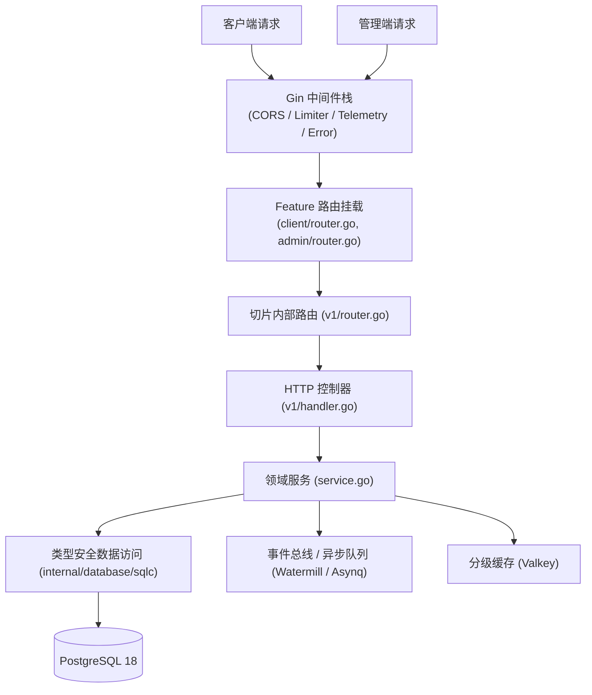

# cgin

企业级高并发 RESTful Web API 骨架，基于 Go 1.27+ 与 Gin 构建，采用 Feature-First（垂直切片）架构。

## Technology Stack

| 类别 | 选型与版本 | 说明 |
| :--- | :--- | :--- |
| **运行时** | Go 1.27+ | 现代 Go 标准，开启严格类型与并发安全 |
| **Web 核心** | Gin (`v1.12.0`) | 经典高性能 HTTP Web 框架与 gin-contrib 中间件生态 |
| **数据访问** | sqlc (`1.31.1`) + pgx/v5 (`v5.12.0`) | 编译期离线生成类型安全查询集，底层运行 PostgreSQL 18 |
| **数据库迁移** | Atlas CLI | 声明式 Schema 驱动的版本化 SQL 迁移 |
| **缓存体系** | Valkey + rueidis (`v1.0.79`) | 高性能 Redis 协议兼容缓存与分布式锁 |
| **鉴权授权** | JWT (`golang-jwt/v5`) + Casbin (`casbin/v2`) | 无状态双令牌 + RBAC 静态访问控制矩阵 |
| **异步与事件** | Watermill (`v1.5.3`) + Asynq (`v0.26.0`) | 内存事件总线/CQRS 路由与 Redis 分布式延迟队列 |
| **实时通信** | Centrifugo (`gocent/v4`) | 连接凭据签发与私有频道鉴权代理 |
| **依赖注入** | samber/do/v2 (`v2.1.0`) | 类型安全 IoC 容器与生命周期管理 |
| **命令行** | spf13/cobra (`v1.10.2`) | Artisan 风格分层 CLI 系统 |
| **结构化日志** | log/slog + slog-zerolog/v2 | 官方门面与 Zerolog 引擎，支持全链路脱敏 |
| **API 规范** | Swag + OpenAPI 2.0/3.0 | 代码注解自动解析并嵌入二进制 (`api/`) |

## Project Architecture

采用业务特性优先（Feature-First / Vertical Slice）设计，顶层严格区隔前台客户端与后台管理端：



架构依赖核心原则：
- **单向依赖规约**：切片根目录服务层承载业务规则，严禁反向 import 自身的 `v1/` 传输层；`client` 与 `admin` 特性之间互不依赖。
- **分层职责隔离**：Handler 仅负责参数提取、校验调度与成功响应信封；业务事务完全收敛于 Service；DTO 仅承载契约与校验标签。
- **跨模块内核沉淀**：跨切片共享模型统一收敛于 `internal/user/`，媒体底层抽象收敛于 `pkg/media/`。

## Getting Started

### Prerequisites

- Go 1.27+
- Just 任务运行器
- PostgreSQL 18
- Valkey（或 Redis 7.0+）
- Atlas CLI
- sqlc

### Setup & Run

1. **环境初始化**：
   ```bash
   just init
   ```
   自动生成 `.env`、签发 JWT 与应用双密钥、创建本地数据库、执行版本迁移并播种初始管理员。

2. **开发模式运行**：
   ```bash
   # 并行热重载 API 与 Worker（带 process-compose TUI 面板）
   just dev

   # 纯终端流式日志输出（无 TUI）
   just dev-stream
   ```

3. **直接运行与编译**：
   ```bash
   # 单独运行 API
   just run --port 3300

   # 单独运行 Worker
   just work

   # 编译生产二进制至 bin/cgin
   just build
   ```

## Project Structure

```
cmd/api/main.go                 # 应用程序入口与 CLI 控制权移交
api/                            # OpenAPI 契约与嵌入式 JSON (swagger.json, admin_swagger.json)
internal/                       # 私有业务实现层 (Feature-First 垂直切片)
├── bootstrap/                  # 组合根、DI 容器与服务生命周期管理
├── config/                     # 强类型环境配置 (caarlos0/env)
├── console/                    # Artisan 风格 CLI 子命令与代码生成脚手架
├── database/                   # 连接池、RunInTx 事务协调器与播种器
│   └── sqlc/                   # sqlc 离线生成查询集 (禁止手工改动)
├── enum/                       # 核心领域枚举 (Role, UserStatus, OTPType 等)
├── feature/                    # Feature-First 垂直切片核心
│   ├── admin/                  # 后台管理端特性 (auth, user)
│   ├── client/                 # 前台客户端特性 (auth, media, payment, profile, realtime, user)
│   └── system/                 # 系统级探针与运维端点
├── middleware/                 # 全局与路由级中间件
└── user/                       # 用户领域视图与共享基础仓储
database/                       # SQL 唯一事实源
├── schemas/                    # 声明式 DDL (唯一事实源)
├── queries/                    # SQL 业务读写语句
└── migrations/                 # Atlas 版本迁移与完整性校验链
pkg/                            # 跨切片可复用基础设施 (对外公开的原子组件)
└── ...                         # 鉴权、缓存、日志、货币、媒体、通知、存储等原子库
test/                           # 外部测试套件 (镜像 internal 与 pkg)
```

## Key Features

- **垂直切片自包含**：各特性就近内聚业务用例、领域事件、通知模版与异步队列任务。
- **安全与权限管控**：无状态双令牌 JWT 刷新续期、毫秒级纪元注销黑名单、基于 Casbin 的 RBAC 静态权限控制。
- **高精度金融值对象**：基于 shopspring/decimal 的 Money 值对象，支持 ISO-4217 元数据、金融舍入与 Fowler 无损均摊。
- **媒体与预签名处理**：支持客户端直传 S3 预签名凭据签发、安全格式校验与 Imgproxy 动态签名处理。
- **多通道通知派发**：统一抽象邮件、短信、Telegram 与 Gotify 适配器，支持异步队列可靠重试投递。
- **全链路可观测性**：统一 TraceContextHandler、结构化 Zerolog 访问日志、敏感字段自动脱敏及 OpenTelemetry 链路埋点。

## Development Workflow

所有工程操作强制统一通过根目录 `justfile` 执行：

```bash
just dev                # 开发环境多进程并发启动与热重载
just cli route:list     # 查看当前注册路由列表
just cli make:feature   # 交互式脚手架生成新特性垂直切片
just migrate            # 应用数据库版本迁移
just migrate-diff <name># 对比声明式 DDL 生成新迁移文件
just sqlc               # 重新编译生成 internal/database/sqlc
just docs               # 自动化更新 OpenAPI 文档
```

## Coding Standards

- **禁止跨切片反向引用**：特性服务层严禁反向依赖自身 `v1/` 传输层；`client` 与 `admin` 切片严禁直接相互 import。
- **禁止 Handler 侵入业务**：Handler 统一使用强类型绑定提取参数，严禁直接在 Handler 编写业务逻辑或操作 SQL。
- **禁止手工改动生成物**：`internal/database/sqlc` 与 `api/*.json` 必须由 `just sqlc` 和 `just docs` 离线生成。
- **错误统一收敛**：业务异常统一使用 `samber/oops` 携带语义化业务错误码（`pkg/errs/code.go`），由全局错误中间件映射标准契约。

## Testing

单元测试与集成测试解耦，集成测试统一放置在 `test/integration/` 并使用 build tags 区分：

```bash
# 内存级全量单元测试
just test

# 真实依赖集成测试 (依赖本地 Postgres, Valkey)
just test-int

# 单元测试与集成测试全量执行
just test-all

# 测试覆盖率统计
just coverage
```

三级质量门禁体系：
- **提交前本地门禁**：`just check`（执行 `fmt-check` + `lint` + `sqlc-diff` + `test`）。
- **CI 最终门禁**：`just ci`（执行 `fmt-check` + `lint` + `sqlc-diff` + `test-all`）。

## Contributing

1. Fork 本仓库并基于 `main` 分支创建特性分支（如 `feat/order-checkout`）。
2. 在 `internal/feature/<scope>/` 编写垂直切片，并在 `test/internal/feature/` 补充单元测试。
3. 提交信息严格遵循 Conventional Commits 规范（`feat:`, `fix:`, `refactor:`, `test:`, `chore:`）。
4. 提交 PR 前必须确保 `just check` 本地验证通过（0 警告、0 报错）。

## License

本项目遵循 MIT 开源许可证。
